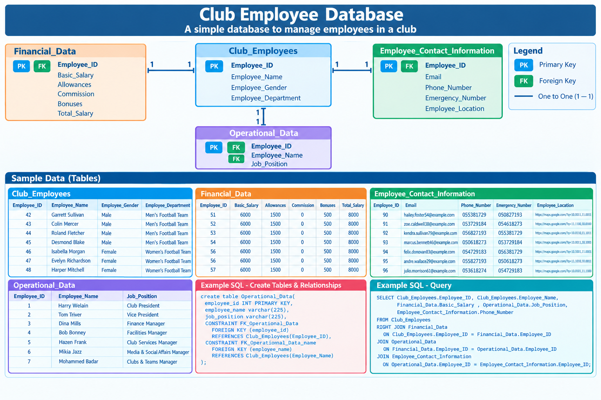
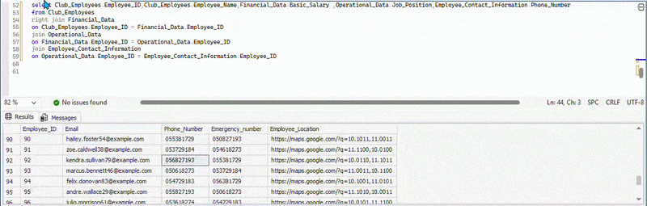

Sports Club Database

  

📝 Project Description

Employee Management Database for a Sports Club

Club Employee Database is a relational database project designed to organize and manage employee information within a sports club. The database stores employee details, financial records, operational information, and contact information in separate, related tables.

The project uses Microsoft SQL Server and SQL to demonstrate relational database design, primary and foreign keys, one-to-one relationships, table creation, and data retrieval using JOIN queries.

🎯 Project Objectives 

The main objective of this project is to apply and practice the SQL concepts I have learned through a practical database project using Microsoft SQL Server.

1- Organize data into separate tables and apply relational database design principles.

2- Create and manage primary and foreign keys (PK & FK) and implement one-to-one relationships.

3- Retrieve and combine data using SQL JOIN queries while improving my understanding of data integrity and SQL query writing.

🛢️ SQL Queries

JOIN

  

where function 

  

order by function

  

📊 Project Results 

1- Created a relational database using Microsoft SQL Server.

2- Designed four related tables to organize employee data.

3- Implemented primary and foreign keys to establish one-to-one relationships.

4- Practiced JOIN queries to retrieve data from multiple tables.

5- Improved my understanding of relational database design and data integrity.

⚠️Note: All data, including names, numbers, and locations, are fictional and created for learning purposes only.
